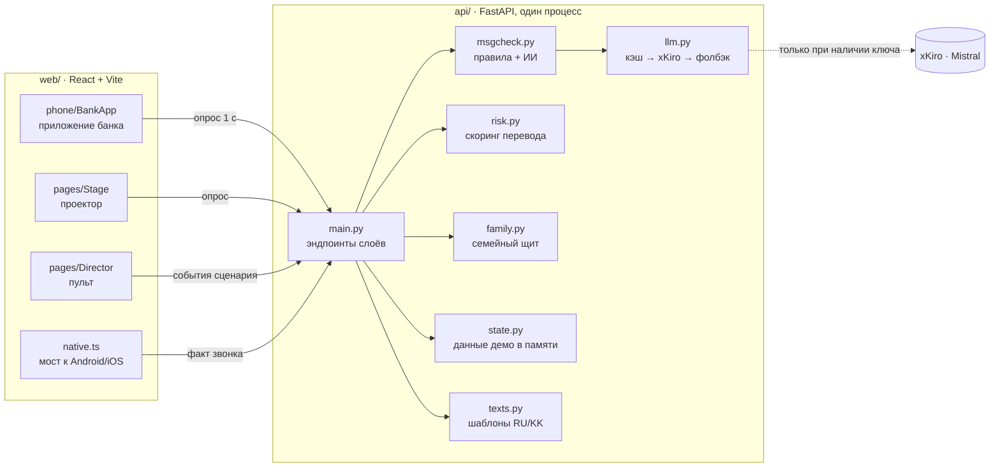
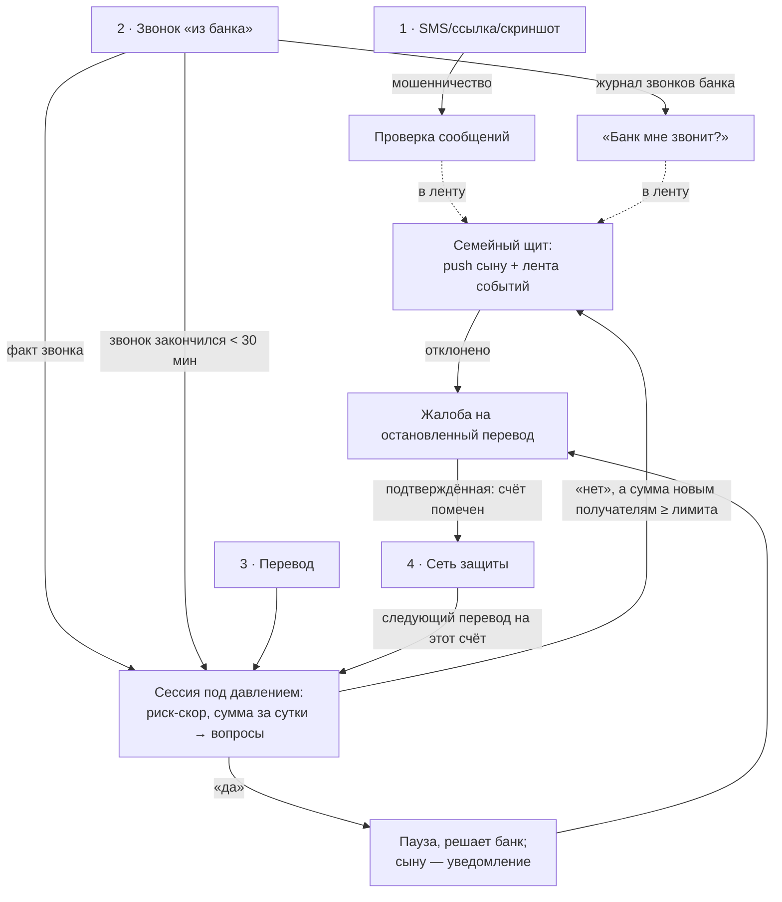

# Архитектура Qaqpan

## Прототип



## Слои и поток сигнала



Жалоба по одному номеру счёта и отказ сына без жалобы — только сигнал (+0,15 к риску): честного продавца одна
жалоба не останавливает.

## Интеграция с антифродом банка

Qaqpan **дополняет** антифрод-систему банка, а не заменяет её. Приложение отдаёт сигналы с телефона, которых у
банка нет; решение остаётся за системой банка; Qaqpan показывает клиенту и семье утверждённый текст.

Запрос приложения к антифроду (при создании перевода):

```json
{
  "client_id": "…", "amount": 900000, "recipient": "KZ86…1934",
  "session": {
    "on_call": true, "seconds_since_call_end": null, "call_minutes": 12,
    "bank_calling_now": false,
    "new_recipients_24h_total": 180000, "first_paid_recipient_ago_s": null,
    "pasted_requisites": true, "app_switches": 2, "remote_access_detected": false,
    "checked_messages_today": [{"verdict": "scam", "scheme": "ecp_egov"}]
  },
  "family": {"guardian": true, "limit_24h": 200000}
}
```

Ответ антифрода:

```json
{"action": "family", "score": 0.85,
 "reasons": ["CALL_ACTIVE", "NEW_RECIPIENT", "BIG_SHARE", "BIG_AMOUNT"],
 "template": "call"}
```

`action`: `allow` / `warn` / `questions` / `family` / `hold`. Коды причин те же, что в `api/risk.py`, тексты — из
`api/texts.py`. В пилоте антифрод банка может сначала только логировать ответ Qaqpan (теневой режим,
`QAQPAN_SHADOW=1`).

## Режимы сервера

| Переменная | Что делает |
|---|---|
| `QAQPAN_DIRECTOR_KEY` | Пульт и сброс — только с ключом ведущего (`?key=…` один раз на устройстве) |
| `QAQPAN_LOCK=1` | Закрытый стенд для финала: любое действие (кроме проверки сообщения) — только с ключом ведущего |
| `QAQPAN_IDLE_RESET_MIN=10` | Публичная ссылка: после 10 минут тишины следующий посетитель видит чистое демо |
| `QAQPAN_SHADOW=1` | Теневой пилот: риск и причины считаются и пишутся в ленту, переводы не задерживаются |
| `QAQPAN_DEMO=1` | ИИ только из кэша, без интернета |
| `QAQPAN_LLM_TIMEOUT`, `_RPM`, `_DAILY` | Таймаут живого вызова ИИ (12 с) и лимиты расходов |

## В банке (после пилота)

| Прототип | Продакшен |
|---|---|
| `state.py`: данные в памяти | Процессинг и профиль клиента банка |
| Журнал исходящих звонков — мок | API колл-центра банка |
| Сигнал звонка с пульта / `native.ts` | Системный API внутри приложения банка (`AudioManager.getMode()`, `CXCallObserver`) |
| Жалобы внутри одного банка | Обмен через Антифрод-центр Нацбанка между всеми участниками |
| Связь мамы и сына задана заранее | Приглашение и согласие доверенного лица, подтверждение решения биометрией |
| ИИ через xKiro (Mistral) | Модель внутри контура банка; тексты клиенту — утверждённые шаблоны |
| Веса скоринга вручную | Модель на размеченных переводах банка с теми же кодами причин |
| Признак «только что полученный кредит» — по данным в памяти | Данные кредитного конвейера банка (выдача < 72 ч, половина суммы — новому получателю) |
