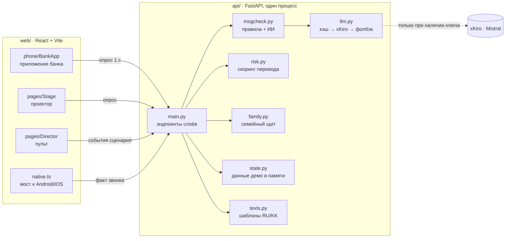
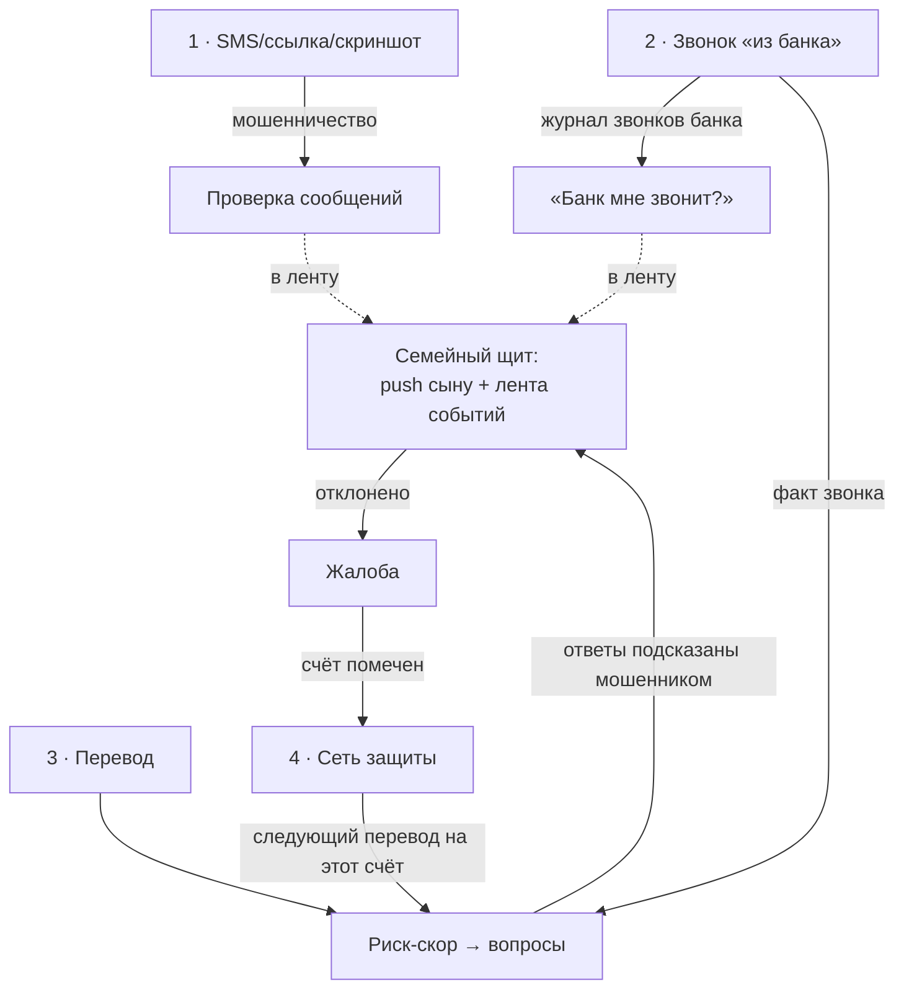

# Архитектура Qaqpan

## Прототип

## Слои и поток сигнала

## В банке (после пилота)

| Прототип | Продакшен |
|---|---|
| `state.py`: данные в памяти | Процессинг и профиль клиента банка |
| Журнал исходящих звонков — мок | API колл-центра банка |
| Сигнал звонка с пульта / `native.ts` | Системный API внутри приложения банка (`AudioManager.getMode()`, `CXCallObserver`) |
| Жалобы внутри одного банка | Обмен через Антифрод-центр Нацбанка между всеми участниками |
| Связь мамы и сына задана заранее | Приглашение и согласие доверенного лица, подтверждение решения биометрией |
| ИИ через xKiro (Mistral) | Модель внутри контура банка; тексты клиенту — утверждённые шаблоны |
| Веса скоринга вручную | Модель на размеченных переводах банка с теми же кодами причин |
